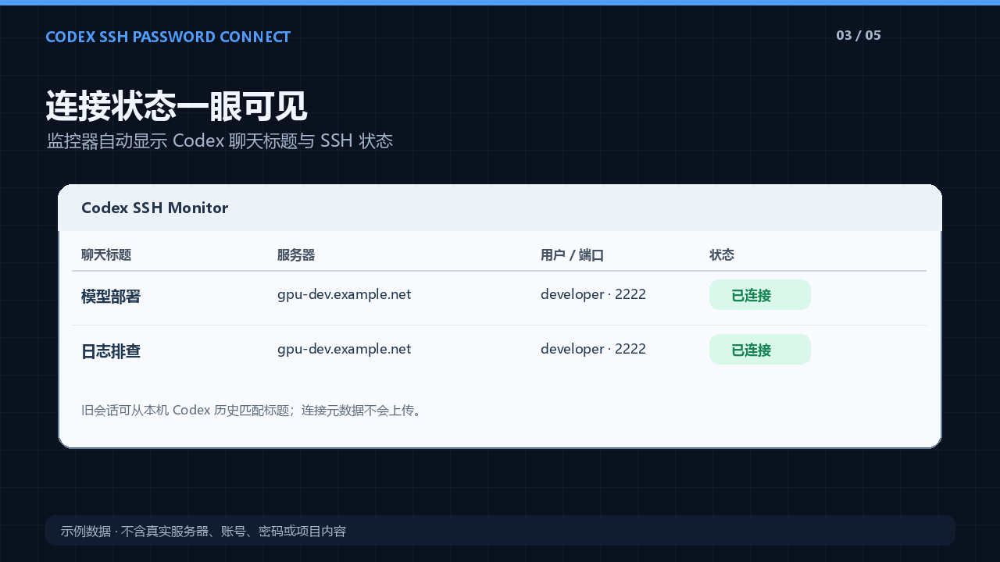

# Codex SSH Password Connect

**Use Codex on your Windows PC to inspect and edit a project that stays on an SSH server.** The MCP bridge runs locally and supports password login or optional private-key authentication. SSH/SFTP handles remote commands and file operations. No Codex agent or VS Code Server is installed on the remote host, and the repository is not mirrored to the PC.

[简体中文说明](README.zh-CN.md) · [Short demo video](docs/demo.mp4) · [Security notes](SECURITY.md)

> The demo uses fictional server details. No real credentials or project contents are included.



## What it does

- Supports a local SSH password prompt or private-key authentication. Passwords, private-key contents, and key passphrases are not sent as model tool arguments or written to plugin configuration.
- Reuses matching active connections in the same MCP chat and coalesces simultaneous connect calls, avoiding duplicate login prompts.
- Pins the server host-key fingerprint after first-use confirmation and rejects a changed key.
- Opens a single-instance connection monitor after SSH succeeds. For Codex, it resolves the chat title from the MCP thread ID and the local Codex title database. Installer backfill can match older SSH connection records to local tool history.
- Keeps project files on the server. Codex reads and edits them through SFTP and runs commands on the server.
- Supports large UTF-8 text files through bounded range reads, streamed exact-text patches, and staged chunk uploads.
- Uses Codex approval prompts for remote commands and file writes.

## Install

Requirements: Windows, Node.js 22.5 or later, and Codex or the Codex extension for VS Code.

1. Download [CodexSSHPasswordConnect-1.6.4-win-x64.zip](https://github.com/gengyuang5-lang/codex-ssh-password-connect/releases/download/v1.6.4/CodexSSHPasswordConnect-1.6.4-win-x64.zip) and extract it to a permanent folder.
2. Run `install.cmd`, or run `install.ps1` from PowerShell. It updates the local plugin, backfills old chat titles, enables the plugin, and removes the duplicate legacy MCP registration.
3. Fully restart Codex and VS Code so they load the updated plugin. Already-running MCP processes keep their current code until the app exits.
4. Start `CodexSSHMonitor.exe` manually if needed. It also opens automatically after an SSH connection succeeds.

The release archive includes the Node dependencies. For a source checkout without `node_modules`, run `npm ci --omit=dev` in the project folder before installing.

## Connect and work

Ask Codex to connect using the server hostname, SSH port, and account, for example:

```text
Connect to gpu-dev.example.net on port 2222 as developer, then inspect /srv/my-project.
```

With password auth, enter the password in the Windows credential dialog. To use key auth, ask Codex to use the private key on this PC. The first time, select it in the local file picker; the path is remembered on this PC, and later key-auth connections use it automatically without a picker. Only use the separate `ssh_set_default_private_key` tool when you explicitly want to change the default key. An encrypted key may still ask for its passphrase in a local dialog. The server must already have the matching **public key** in `authorized_keys`. On first contact, verify the displayed host fingerprint. Tell Codex which remote project directory to use, then ask it to inspect or edit files and run project commands. Never paste a password, private key, or passphrase into chat.

The monitor displays the Codex chat title next to the SSH connection. The plugin resolves Codex thread metadata against the local title database. If the client omits thread metadata, it retries a local SSH-history match a few seconds after connecting. Other MCP clients can pass a concise `chatLabel` if supported. Repeated calls to the same target in one chat reuse the active session; use `forceNew: true` only when you intentionally want a separate connection.

## Large files

The 256 KiB limit applies only to the one-call `ssh_read_file` and `ssh_write_file` tools. Larger UTF-8 text files can be read in ranges of up to 32 KiB and patched as a streamed remote file. New large text files are uploaded in chunks of up to 32 KiB, checked for UTF-8 and optional SHA-256, and committed through a server-side temporary file.

Each patch fragment is limited to 16 KiB. Uploading or patching a large existing file requires temporary free space on the server. The special range, patch, and upload tools support UTF-8 text, not binary files.

## Security and data

See [SECURITY.md](SECURITY.md) for the local data inventory, host-key behavior, approval model, and limitations. Status snapshots and title mappings stay under `%APPDATA%\CodexSSH`; they do not contain passwords or project file contents. The plugin sends no telemetry.

## Known limits

- This is remote-first MCP tooling, not a transparent remote IDE. Server-side language servers, indexing, and full VS Code Remote SSH behavior are not provided.
- The dedicated large-file tools currently handle UTF-8 text. They do not implement full binary WinSCP synchronization.
- SSH processes started independently in PowerShell, CMD, or another application are outside the monitor's scope.
- If a network failure interrupts an upload, an uncommitted hidden temporary file may remain on the server. A normal `ssh_disconnect` cleans active uploads.

## Build and release package

From a source checkout with dependencies installed:

```powershell
npm ci --omit=dev
.\tools\package-release.ps1
```

The packaging script validates the manifests, builds the monitor, creates the demo video, and writes a versioned ZIP plus SHA-256 checksum to `outputs\release` by default.

## License

This source package does not include a license yet. Reuse and redistribution terms remain to be selected by the project owner.
